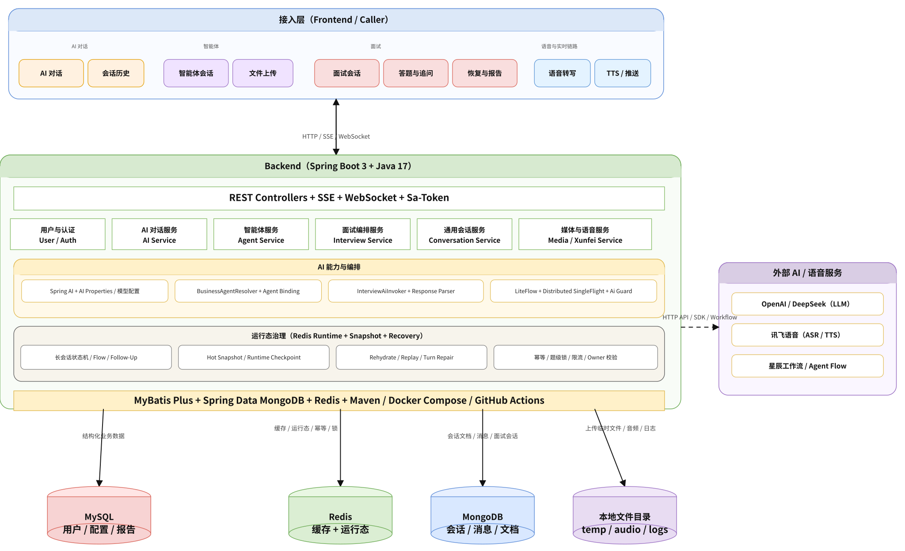

# AI Meeting

AI 模拟面试平台：上传简历后自动出题，多轮问答、追问和评分，结束后生成面经和错题集。

底座来自 [lishuangqiang/AI-Meeting](https://github.com/lishuangqiang/AI-Meeting) 及其前端 [AI-Meeting-Frontend](https://github.com/lishuangqiang/AI-Meeting-Frontend)（MIT）。在这个底座上，我重做了面试主链路中“追问”这一段，并补上了控时、面经、错题复习和会话删除。

## 为什么要改

原来的追问由模型看完回答后自己决定：要不要追问、追问什么。评分也只给分数和评语，没有依据。放到一场 20～45 分钟的面试里，会有三个问题：

- **节奏不可控**：追问次数和内容都由模型决定，时间到了，主问题可能还没问完；
- **判断没有依据**：评分说“答错了”，却说不清错在哪、依据是什么；
- **链路长**：一场面试要调十几次模型、跨三种存储，中途超时、进程重启、用户刷新或重复点击时，都得保证不重复计分、不丢回答、题号不错位。

所以这次的重点不是让模型更聪明，而是让这条 AI 长链路**可控、有依据、可恢复**。

## 我做了什么

**控时：主问题固定，追问让位给时间**

- 简历生成的主问题在第一次读取时冻结（顺序、正文和 SHA-256），之后任何环节都不能改；
- 开始前选择 20 / 30 / 45 分钟，服务端计时，刷新不会重置；
- 每次决定是否追问前都会重算预算：剩余时间 − 剩余主问题预留 − 收尾 − 缓冲。不够就不追问，先把主问题问完。超时后可以延长，每次 5 分钟，最多 15 分钟。

**有依据的追问（RAG）**

- 本地知识目录按岗位和技术版本过滤，每个知识点带评分要点、官方资料片段和审核过的追问模板；
- 模型只负责“看回答、给证据”：对每个评分点给出状态（覆盖 / 部分 / 错误 / 未提及 / 不确定），并引用回答原文和资料 ID；
- 程序校验证据：引用必须能在回答原文中找到，资料必须来自本轮检索结果，否则降为“不确定”。没提到不算错；
- 追问由 LiteFlow 规则选择，只能从审核过的模板里挑。排序是确定的，同样的输入重放会得到同样的结果；
- 展示给用户的反馈由程序根据校验后的证据和资料生成，不直接透传模型的自由解释。

**一条答题请求只生效一次**

- 自适应会话整体存成 MongoDB 的一个文档，用 `@Version` 乐观锁提交：分数、题号推进、证据、决策和响应在同一次写入里完成，Redis 和 MySQL 只是可重建的投影；
- 回答先存为 pending，模型结果返回后也先落盘，然后再决策和提交。进程中途退出后重试，会直接复用已保存的模型结果，不重复调用、不重复加分；
- 同一个 requestId 重试会返回第一次的响应；同 ID 但内容不同则报冲突。

**面经和错题**

- 面试结束与“报告待生成”在同一次写入中完成；后台 worker 带租约领取任务，失败按 10s / 30s / 120s 退避，3 次后标记失败，可以手动重试。租约过期后其他实例可以接手，旧 worker 的结果不会覆盖新结果；
- 面经由已提交的问答、证据和资料拼成 Markdown，不再额外调用模型总结；
- 错题按知识点和缺口去重入集，复习时两次独立答对才算掌握；用户手动纠正或移除的记录不会被报告重试覆盖。

**删除**

- 已结束的面试可以删除：先写入只含身份信息的删除标记，再清理 Mongo / MySQL / Redis 和错题来源，失败由后台每 10 秒补偿；正在跑的报告任务看到标记就放弃发布。

设计细节见 [docs/adaptive-interview.md](docs/adaptive-interview.md)，测试与评测见 [docs/testing.md](docs/testing.md)。

## 底座已有的功能

- 简历 PDF 上传、解析与结构化提取
- 根据简历生成面试题，多轮问答、评分、能力雷达图、逐题回放
- AI 对话与 Agent 流式输出（SSE）
- WebSocket 实时语音识别，讯飞长文本语音合成
- Sa-Token 登录鉴权与角色权限
- Redis 分布式锁、限流、缓存与 AI 请求去重
- MongoDB 会话快照与长会话恢复

## 架构

```text
前端 ── HTTP / SSE / WebSocket ──> Spring Boot 后端
                                      ├── MySQL：用户、权限、业务配置
                                      ├── MongoDB：对话、面试记录、自适应会话、错题
                                      ├── Redis：缓存、锁、限流、会话状态
                                      └── AI / 讯飞：模型、语音识别、语音合成
```



| 技术 | 用途 |
| --- | --- |
| Java 17 / Spring Boot 3.4.4 | 应用框架 |
| Spring AI 1.0.0 | 模型接入 |
| MyBatis-Plus + MySQL 8 | 用户、权限和业务配置 |
| MongoDB 7+ | 对话、面试数据、自适应会话与错题 |
| Redis 7 / Redisson | 缓存、分布式锁、限流 |
| LiteFlow | 追问裁决规则 |
| Sa-Token | 登录认证与权限 |
| React + TypeScript + Vite | 前端（`frontend/`） |

## 快速开始

需要 JDK 17+、Node 22、Docker，以及一个 OpenAI 兼容的模型接口。语音功能另需讯飞开放平台凭证。

```bash
cp .env.example .env          # 填好模型和数据库配置
docker compose up -d --build  # 启动 MySQL、MongoDB、Redis 和后端
```

后端默认地址为 `http://localhost:8002`，健康检查为 `/actuator/health`。也可以先自己起好三个数据库，再本地运行：

```bash
./mvnw -pl admin spring-boot:run
```

前端：

```bash
cd frontend
cp .env.example .env
npm ci
npm run dev
```

`docker compose --profile web up -d` 会额外启动一个 Nginx，地址为 `127.0.0.1:8088`，并把 `/api` 转发给后端。

MySQL 初始化脚本在 `admin/src/main/resources/sql/`，首次创建数据卷时自动执行。自适应面试用到的 Mongo 索引在 `scripts/adaptive-indexes.js`，执行方式见设计文档。

## 配置

| 环境变量 | 默认值 | 说明 |
| --- | --- | --- |
| `SERVER_PORT` | `8002` | 后端端口 |
| `MYSQL_HOST` / `MYSQL_PORT` / `MYSQL_DATABASE` | `127.0.0.1` / `3306` / `mainshi_agent` | MySQL |
| `MONGODB_HOST` / `MONGODB_PORT` / `MONGODB_DATABASE` | `127.0.0.1` / `27017` / `xunzhi_agent` | MongoDB |
| `REDIS_HOST` / `REDIS_PORT` | `127.0.0.1` / `6379` | Redis |
| `SPRING_AI_OPENAI_API_KEY` / `_BASE_URL` / `_MODEL` | - | 模型接口 |
| `XUNFEI_APP_ID` / `XUNFEI_API_KEY` / `XUNFEI_API_SECRET` | - | 讯飞凭证 |
| `INTERVIEW_ADAPTIVE_ENABLED` | `false` | 是否允许新会话使用自适应面试 |
| `INTERVIEW_ADAPTIVE_MODE` | `SHADOW` | `TIME_ONLY` / `SHADOW` / `ADAPTIVE`，会话创建时冻结 |

自适应面试的完整配置项见设计文档。不要把真实密钥提交到仓库。

## 测试

```bash
docker run -d --name ai-meeting-mongo -p 127.0.0.1:28029:27017 mongo:8.0   # 集成测试用
./mvnw -B -ntp clean verify
cd frontend && npm run check && npm run build
```

集成测试会连接 `127.0.0.1:28029` 上的 MongoDB（可以用 `AI_MEETING_TEST_MONGO_URI` 覆盖），每个测试使用随机库名，用完即删。CI 会跑同样的命令。

## 当前状态

- 自适应面试默认关闭，本地验证时需要手动打开；
- 知识目录目前只有 4 个主题：Java equals/hashCode、volatile、MySQL 8 InnoDB 隔离级别、Redis 缓存问题；
- 评分质量只在合成数据上评估过（60 条验收集严格通过 52 条），标签还没有经过人工复核；
- 新链路下的语音识别和语音合成还没有用真实讯飞凭证跑通。

## 目录结构

```text
AI-MEETING/
├── admin/                  # Spring Boot 后端
│   └── src/main/java/.../interview/adaptive/   # 自适应面试
├── frontend/               # React 前端
├── docs/                   # 设计、测试文档和评测数据
├── scripts/                # 索引脚本、模型评测脚本
├── skills/ mcp/            # 给 AI 编码助手用的领域说明和工具
├── docker-compose.yml
└── Dockerfile
```

## License

MIT，见 [LICENSE](LICENSE)。底座部分版权归原作者所有。
