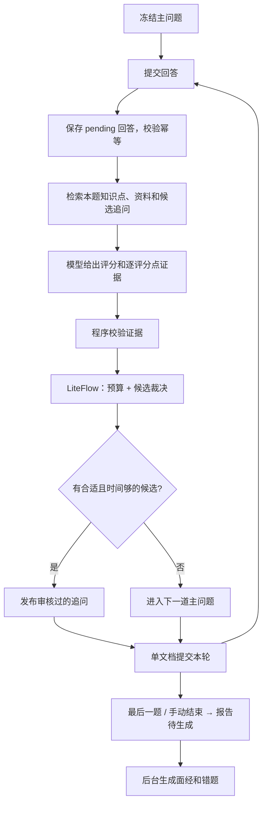

# 自适应面试设计

这份文档说明自适应面试（控时 + 有依据的追问 + 面经错题）是怎么设计的，以及为什么这样设计。代码在 `admin/src/main/java/com/hewei/hzyjy/xunzhi/interview/adaptive/`。

## 1. 目标与边界

要解决的问题：在不改动简历生成的主问题的前提下，根据回答情况和剩余时间决定追不追问、追问什么；面试结束后自动生成面经，把答错的知识点收进错题集。

几条贯穿整个设计的约束：

1. **主问题不可变**：生成后的内容、顺序和数量固定，控时和追问逻辑都不能删题、改题、重排。
2. **模型不决定流程**：模型输出里只有分数和证据，没有“下一题”“结束”之类的动作字段；就算模型输出了，也不会被采用。
3. **追问只来自审核过的模板**：不让模型现场生成追问题目。
4. **时间和次数是硬门禁**，优先级高于任何模型判断。剩余主问题的时间永远是预留的。
5. **没提到不等于不会**：未涉及、证据不足、分析失败都不能判成“答错”。
6. **一次答题请求只提交一次**：分数、题号推进、追问计数和证据要么一起生效，要么都不生效。
7. **个人数据按用户隔离**：面经、错题和复习记录都要校验归属。

刻意没做的：向量数据库、知识图谱、长期能力画像、严格到点打断回答。第一版先用关键词/知识点检索把整条链路跑通，检索方式以后可以替换。

## 2. 主流程



| 类 | 职责 |
| --- | --- |
| `AdaptiveInterviewService` | 会话配置、计时、答题提交、结束、恢复，以及对外的锁和归属校验 |
| `AdaptiveFollowUpPolicy` | 纯函数：预算计算和候选裁决，不依赖时钟和模型，可以重放 |
| `AdaptiveRuleEngine` / `AdaptiveSelectNode` | 把裁决接到 LiteFlow 链 `adaptive_followup_v1` 上 |
| `InterviewKnowledgeCatalog` | 加载、校验知识目录，按范围和主题检索 |
| `WorkflowGroundedInterviewEvaluator` | 调用外部评分工作流，解析结构化输出 |
| `InterviewEvidenceValidator` | 校验模型给出的证据 |
| `GroundedFeedback` | 根据校验后的证据和资料生成展示给用户的反馈 |
| `InterviewReviewService` | 报告任务、面经渲染、错题入集和复习 |
| `AdaptiveSessionDeletionService` | 会话删除和补偿清理 |
| `MongoAdaptiveSessionStore` | 会话文档的存取（带版本号） |

## 3. 控时

### 3.1 计时

- 用户上传简历前，选择 20 / 30 / 45 分钟的软目标（`PUT /sessions/{id}/policy`）；
- **第一次成功下发主问题**时，服务端原子地写入开始时间。从这个时间点开始算，而不是从上传简历开始，因为它是服务端能确定的时间点；
- 刷新、重连、重试都不会重置计时，结束后计时冻结；
- 超时后用户可以选择继续答主问题、延长 5 分钟（累计最多 15 分钟），或直接结束。

### 3.2 预算公式

```text
elapsed   = max(0, now - startedAt)
remaining = target + extension - elapsed
reserve   = 所有尚未作答的主问题的预计耗时之和
followUpBudget = remaining - reserve - closing(60s) - buffer(60s)
```

候选追问的预计耗时（模板里配置，15～600 秒）不超过 `followUpBudget` 才有资格。

举个例子：30 分钟场次，已经用了 16 分钟，还剩 6 道主问题，每道预留 120 秒。那么 `1800 - 960 - 720 - 60 - 60 = 0`，不再追问，后面全部按主问题走。

预算状态分三档：`ON_TRACK`、`TIME_TIGHT`（预算不足 90 秒）、`OVERTIME`，前端据此显示提示。

## 4. 知识目录与检索

目录文件是 `admin/src/main/resources/knowledge/interview-catalog-v1.json`，当前版本为 `java-starter-v4`。每个主题包含：

- 适用岗位和技术版本白名单（例如 `java: 17`、`mysql: 8.0`）；
- 评分要点（rubric points），最多 10 个；
- 资料片段：来源 URL、版本、摘要，每段不超过 2000 字符，最多 6 段；
- 追问候选：最多 5 个，每个有 gapKey、适用的证据状态、优先级、预计耗时，以及是否为“中性”模板（不预设用户答错）；
- 匹配用的别名和别名组。

检索流程：

1. 会话配置时冻结检索范围（岗位 + 技术版本），之后不能扩大。不在范围内的主题直接排除，并记录原因：`ROLE_MISMATCH`、`TECHNOLOGY_VERSION_MISMATCH` 或 `KNOWLEDGE_SCOPE_MISSING`；
2. 主问题冻结时，按别名把每道题映射到主题。别名组要求组内所有词同时出现，避免 “Java Serializable” 误命中 “MySQL SERIALIZABLE”；
3. 会话保存过滤后的目录快照和内容哈希。目录文件以后更新不会影响已经开始的会话，错题复习也读取来源会话的快照；
4. 每次答题最多取 5 个主题、6 段资料交给模型。没匹配上的主问题照常评分，只是不追问、不做知识点判断。

候选模板可以在线撤销（`xunzhi-agent.interview.adaptive.revoked-candidate-ids`），撤销在发布前的最后一道门禁处生效。

## 5. 证据与校验

### 5.1 模型输出

评分走外部工作流 `Grounded Interview Evaluator v1`（定义在 `admin/src/main/resources/workflow/grounded-interview-evaluator-v1.yml`）。输入是题目、回答、评分要点和资料；**不给模型看候选追问**。输出格式如下：

```json
{
  "score": 70,
  "feedback": "本轮反馈",
  "analysisSchemaVersion": "1",
  "observations": [{
    "knowledgePointId": "java.volatile",
    "rubricPointId": "atomicity",
    "state": "INCORRECT",
    "answerQuotes": ["volatile 能保证 i++ 原子性"],
    "sourceChunkIds": ["java-jls17-memory"],
    "rationale": "复合自增并非原子操作"
  }]
}
```

状态取值为 `COVERED / PARTIAL / INCORRECT / NOT_OBSERVED / UNCERTAIN`。格式不对（缺 feedback、schema 版本不符等）会明确失败，pending 的回答保留，等待重试。

### 5.2 程序校验（`InterviewEvidenceValidator`）

- 知识点和评分点必须属于本题检索到的主题；不属于的直接丢弃；
- `answerQuotes` 做 NFKC 归一化、压缩空白后，必须能在回答原文里找到；
- `sourceChunkIds` 必须来自本轮检索结果，而且属于对应主题；
- `COVERED / PARTIAL / INCORRECT` 只要引用或来源有一项不合格，就降为 `UNCERTAIN`；
- 同一评分点出现两个不同状态，记为 `UNCERTAIN`，不取最后一个。

### 5.3 反馈不透传模型原话

联调时发现，就算状态判断对了，模型写的解释里也经常夹带资料里没有的说法。所以对有资料支撑的题目，展示给用户的反馈和解释由 `GroundedFeedback` 根据校验后的状态、回答摘录和资料原文拼出来，模型的自由文本只用于内部记录。没有匹配到主题的题目，仍然沿用原来的模型反馈。

分数仍然是模型给的，属于辅助判断。

## 6. 追问裁决

`AdaptiveFollowUpPolicy.decide` 按固定顺序短路，每一步都留下原因码：

1. 追问被禁用（全局紧急开关、上限配置为 0）→ `FOLLOW_UP_DISABLED`
2. 单题上限（默认 2）→ `PER_MAIN_LIMIT`；全场上限（默认 6）→ `SESSION_LIMIT`
3. 预算 ≤ 0 → `TARGET_TIME_EXCEEDED` 或 `TIME_RESERVED_FOR_MAIN`
4. 本题没有映射到主题 → `KNOWLEDGE_UNMAPPED`
5. 逐个过滤候选：已撤销、该缺口已经追问过、知识点会在后面的主问题里考到、已经答对、证据状态不匹配、时间不够
6. 排序：证据优先级（明确错误 > 必要缺口 > 不确定）→ 模板优先级 → 预计耗时 → 候选 ID
7. 选第一个；没有候选 → `NO_ELIGIBLE_CANDIDATE`

选中候选后，在提交前用新的时间**再跑一遍裁决**。如果结果变了（例如这期间预算用完），就放弃这次追问，记为 `BUDGET_CHANGED_BEFORE_COMMIT`。这一步不会再调用模型。

所有被排除的候选和原因都保存在本轮决策里，前端只显示“为剩余主问题预留时间”这类提示。

### 运行模式

| 模式 | 行为 |
| --- | --- |
| `TIME_ONLY` | 只看时间和次数，只用中性模板，不看模型证据 |
| `SHADOW` | 实际按 `TIME_ONLY` 执行，同时把 `ADAPTIVE` 会怎么选记录下来，用来对比 |
| `ADAPTIVE` | 完整链路 |

模式在会话创建时冻结。紧急关闭追问只影响后续追问，不会退回到旧的“模型自由追问”。

## 7. 一致性：答题提交

这是整个设计里最花心思的部分。

### 7.1 为什么用单文档

一轮答题要改的东西很多：pending 回答、模型结果、证据、决策、追问计数、题号游标、分数、响应。如果分散在 Redis、Mongo 和 MySQL 里，不管先写哪个，中间都会有半提交窗口，只能靠补偿任务对齐。

自适应会话把这些全部放进 Mongo 的一个文档（`interview_adaptive_session`），用 `@Version` 做乐观锁。一次 `save` 就是一次原子提交，Redis 和 MySQL 只是从这个文档派生的投影，随时可以重建。这样不需要副本集事务。

### 7.2 提交顺序

```text
加会话锁（Redis，watchdog 续期，默认最多等 2 秒）
  ├─ requestId 已提交？→ 校验内容哈希，相同则补投影后返回原响应，不同则 REQUEST_PAYLOAD_CONFLICT
  ├─ 校验会话状态和题号
  ├─ 没有 pending → 写入 pending（requestId + 原文 + 哈希）        ← 写入①
  ├─ pending 里没有模型结果 → 调模型 → 校验 → 存进 pending       ← 写入②
  ├─ 裁决 → 提交前复核
  └─ 追加 turn（含证据、决策、响应），清空 pending，推进游标      ← 写入③（提交点）
投影到 Redis / MySQL
```

### 7.3 每个位置崩溃会怎样

| 崩溃位置 | 重试时的行为 |
| --- | --- |
| 写入①之前 | 什么都没保存，相当于第一次请求 |
| ①之后、模型返回之前 | 找到同一个 pending，重新调用模型 |
| 模型返回之后、②之前 | 同上，会重新调用一次模型（这是唯一可能重复付费的窗口） |
| ②之后、③之前 | 直接复用保存的模型结果，不调模型，重新裁决并提交 |
| ③之后、投影之前 | 按 requestId 找到已提交的 turn，补投影，返回原响应 |

另外两种情况：

- 同一题已经有一个 pending，又来了另一个 requestId 的回答（比如在另一个标签页提交），会被拒绝，提示用原请求重试，避免两份回答抢同一道题；
- 两个请求同时到达时，第二个会等锁；锁等待超时就明确报错。就算锁失效，版本号也会拒绝基于旧数据的写入。

结论：分数和题号推进是 exactly-once 的，模型调用是 at-least-once 的。

### 7.4 结束与报告任务

最后一题答完或用户手动结束时，`finished=true` 和 `reportStatus=PENDING` 在同一次写入里提交，所以不会出现“面试结束了但没有建任务”的情况。

后台 worker 每 5 秒扫描一次：已结束、未删除、未成功或失败、到了重试时间、租约已过期的会话。

- 领取：写入随机租约 ID，租约 120 秒，尝试次数 +1；
- 发布前重新读取文档，确认租约还是自己的、还没过期，才写入结果。否则说明被别的 worker 接手了，直接放弃；
- 失败时按 10s / 30s / 120s 退避，第 3 次失败标记 `FAILED`，用户可以手动重试。

报告用已提交的 turn 拼成 Markdown（问答原文、证据、资料），不额外调用模型。

## 8. 错题与复习

错题单独存在 `interview_adaptive_mistake`，`_id` 是“用户 + 知识点 + 评分点 + 错误类型 + 目录版本 + 检索范围”的哈希。同一个缺口跨场次只有一条记录，来源场次记在列表里。

| 本场证据 | 类型 | 初始状态 |
| --- | --- | --- |
| `INCORRECT`：有依据的明确错误 | `CONCEPT_ERROR` | `TO_REVIEW` |
| `PARTIAL`：必要要点缺失 | `REQUIRED_GAP` | `NEEDS_CONFIRMATION`，光凭 PARTIAL 不能确定真的缺了，需要用户确认 |
| `UNCERTAIN`：证据不足 | `NEEDS_CONFIRMATION` | `NEEDS_CONFIRMATION` |
| 同一评分点在后续追问中答对了 | 同上 | `REVIEWING`，证据标记为 `RESOLVED_WITH_PROMPT` |
| `COVERED` / `NOT_OBSERVED`，或者没问到 | - | 不入集 |

复习：

- 每次练习都是独立请求。换一个 requestId 提交同样的内容，不算新的练习；
- 连续两次独立答对 → `MASTERED`（来源 `PRACTICE_VERIFIED`），新的明确错误会打回 `TO_REVIEW`；
- 用户手动标记掌握，来源记为 `SELF_REPORTED`，和练习验证区分开；
- 模型调用失败不增加练习次数，也不判错；
- 用户移除的错题会保留抑制标记，报告任务重跑时不会再把它加回来。

## 9. 删除

已结束的会话可以通过 `DELETE /sessions/{id}` 删除（报告页有二次确认）：

1. 先把会话文档改写成只保留身份信息的删除标记，正文、题目、报告当场清空；
2. 再清理 Mongo 里的题目和轮次归档、MySQL 面试记录、Redis 派生键，以及错题中来自这场的来源和练习；
3. 任何一步失败，后台每 10 秒补偿一次，直到 `deletionComplete=true`；
4. 报告 worker 和其他读接口都会检查删除标记，不会再发布已删除的内容。

同一个错题如果还有其他场次作为来源，会保留下来。供应商托管的文件（简历等）只清理本地引用。

## 10. 配置与上线

| 配置 | 默认 | 说明 |
| --- | --- | --- |
| `INTERVIEW_ADAPTIVE_ENABLED` | `false` | 新会话是否可以配置自适应策略 |
| `INTERVIEW_ADAPTIVE_MODE` | `SHADOW` | 新会话使用的模式 |
| `INTERVIEW_ADAPTIVE_MAX_PER_MAIN` | `2` | 单题追问上限，0 表示禁用 |
| `INTERVIEW_ADAPTIVE_MAX_PER_SESSION` | `6` | 全场追问上限，0 表示禁用 |
| `INTERVIEW_ADAPTIVE_STOP_FOLLOW_UP` | `false` | 紧急关闭，进行中的会话也立即停止追问 |
| `INTERVIEW_ADAPTIVE_REPORT_WORKER` | `true` | 本实例是否领取报告任务 |
| `XUNZHI_AGENT_INTERVIEW_GROUNDED_EVALUATION` | `Grounded Interview Evaluator v1` | 评分工作流绑定名 |
| `xunzhi-agent.interview.answer-guard.adaptive-lock-wait-millis` | `2000` | 答题锁等待时间 |
| `xunzhi-agent.interview.adaptive.report-poll-ms` | `5000` | 报告任务扫描间隔 |
| `xunzhi-agent.interview.adaptive.deletion-poll-ms` | `10000` | 删除补偿间隔 |

**评分工作流**：把 `grounded-interview-evaluator-v1.yml` 导入讯飞工作流平台，选一个有 API 权限的模型，再把 flow ID 和凭证配置好。实测 Spark 的 JSON 格式不稳定，目前用的是 Qwen3-Next-80B-A3B-Instruct。注意不要绑定到原来的“用户答案评分官”，它的输出里没有证据字段。系统提示词另存一份在 `docs/grounded-evaluator-system-prompt.txt`，修改时要和 YAML 同步。

**索引**：

```bash
AI_MEETING_MIGRATION_DB=<目标库名> mongosh '<Mongo URI>/<目标库名>' --file scripts/adaptive-indexes.js
```

脚本会先核对库名再建索引，不删除业务数据。如果存在旧的 `adaptive_mistake_identity` 唯一索引（它没有包含范围字段），会检查定义后移除；定义不一致则中止。

**上线顺序**：先开 `TIME_ONLY` 验证计时和恢复，再用 `SHADOW` 观察 `ADAPTIVE` 的选择是否合理，最后小范围开启 `ADAPTIVE`。

**回退**：优先打开 `INTERVIEW_ADAPTIVE_STOP_FOLLOW_UP`，主问题照常进行；需要停报告就关 `INTERVIEW_ADAPTIVE_REPORT_WORKER`，已有任务保留。回退代码时要保证新版本能读懂会话文档，不能直接降级到不认识新字段的版本。

## 11. 已知不足

- 知识目录只有 4 个主题，资料和候选模板还需要人工审核；
- 模型的语义判断仍有典型错误：把“不知道”判成部分理解、要求题目没问的知识点、对未知实现直接判错。详见 [testing.md](testing.md)；
- 检索是关键词/别名匹配，换个说法就可能漏召回；
- 分数仍由模型给出，没有校准。
